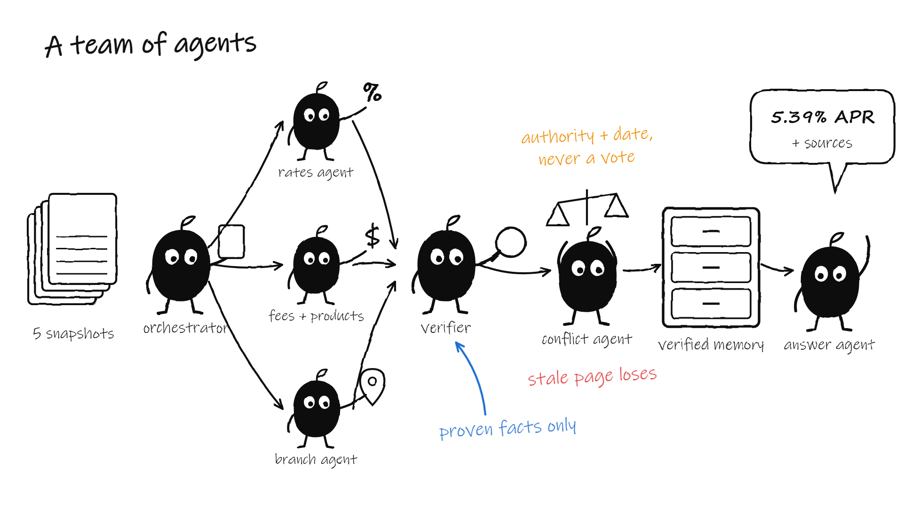
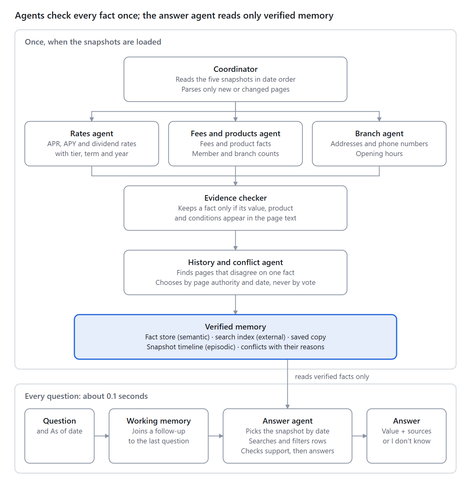

# Credit Union Assistant

A multi-agent knowledge system that answers credit-union member questions from dated copies (snapshots) of a
credit union's website. It gives the current value, the right tier and a cited source. When the website does
not state a fact, it says "I don't know".

Built for a knowledge-system hackathon. Python standard library only: no API keys, no paid services, no
network calls.



**Read the [pitch and design brief](docs/pitch-and-design-brief.md)**: the problem, the agent and memory
architecture, the results, and a side-by-side comparison with a keyword search, a typical RAG chatbot and an
LLM-only bot.

## What is in this repository

| Folder | Content |
|---|---|
| `submission/` | The solution: `solution.py` with `build()`, the agents in `kb/`, tests, the optional web UI and `NOTES.md` |
| `harness/` | The hackathon scorer (`run_eval.py`, `scoring.py`, `contract.py`) and its small artificial self-test data, unchanged |
| `eval/` | The 40 public practice questions, unchanged |
| `docs/` | The pitch and design brief, the architecture diagram and the illustrations |

The website snapshots are **not** in this repository. They were shared for the event only. To run the
evaluation, copy the kit's `snapshots_zip/` folder to the repository root. The scorer unpacks it on the first
run.

## Run the evaluation

Python 3.9 or newer (tested on 3.11.9). There is nothing to install: `submission/requirements.txt` lists no
packages.

```
python harness/run_eval.py --submission submission --eval eval/public_eval.jsonl
python harness/run_eval.py --submission submission --snapshots harness/selftest/snapshots \
       --eval harness/selftest/eval.jsonl --conflicts-gold harness/selftest/conflicts_gold.json
python -m unittest discover -s submission/tests -v
```

## Run the web UI (optional)

```
python submission/app/server.py            # then open http://localhost:8765
```

A chat with a sources box under each answer, an "As of" date menu, follow-up questions, a snapshot timeline
and an FAQ. It runs on 127.0.0.1 only.

## Results (Python 3.11.9)

| Check | Result |
|---|---|
| Public practice set (40 questions) | 0.97 (starter: 0.09) |
| Same questions, reworded / 20 held-out rewordings | 0.93 / 1.0 |
| Self-test with conflict reference | 1.0 |
| Consistency (reworded and repeated questions) | 1.0 |
| Answer time, 95th percentile | under 0.1 s |
| Loading all five snapshots | 18 to 55 s (limit: 30 minutes) |
| Contradictions found and resolved | 37 |
| Unit tests | 25 of 25 pass |

## How it works



An orchestrator agent routes each page to specialist agents (rates, fees and products, branches). A verifier
agent keeps a fact only when the page text proves it. A conflict agent resolves contradictions by source
authority and effective date, never by a majority vote. At question time, the answer agent picks the snapshot
for the date, retrieves verified evidence, and answers with its sources or says "I don't know".

See [`submission/NOTES.md`](submission/NOTES.md) for the rules, the memory design and the known limits.
