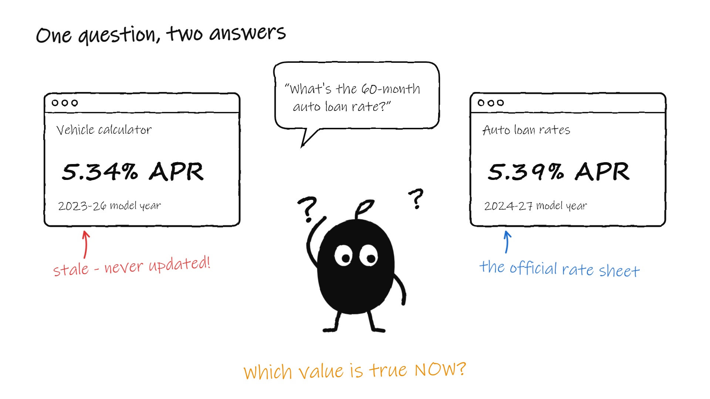
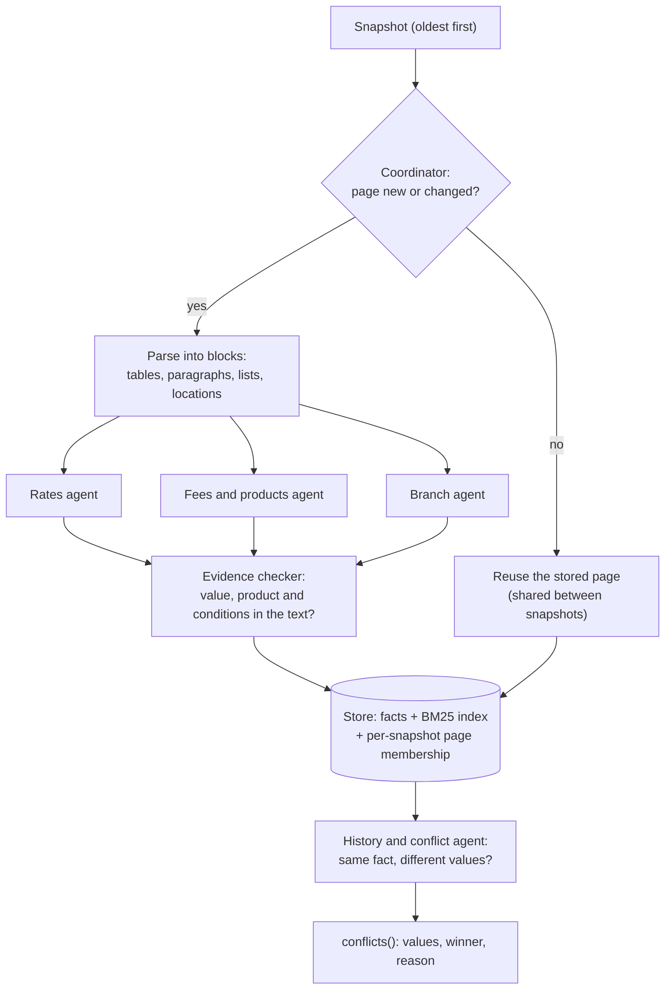
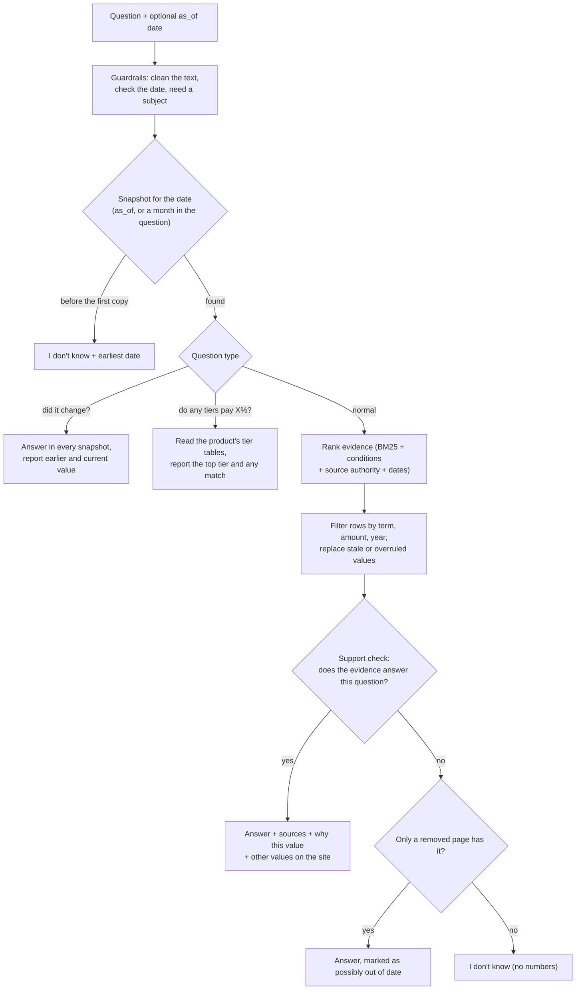
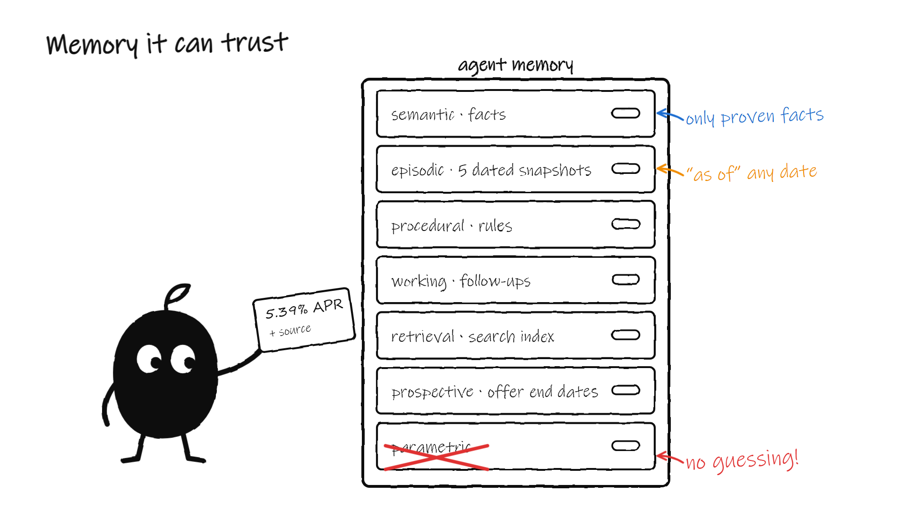
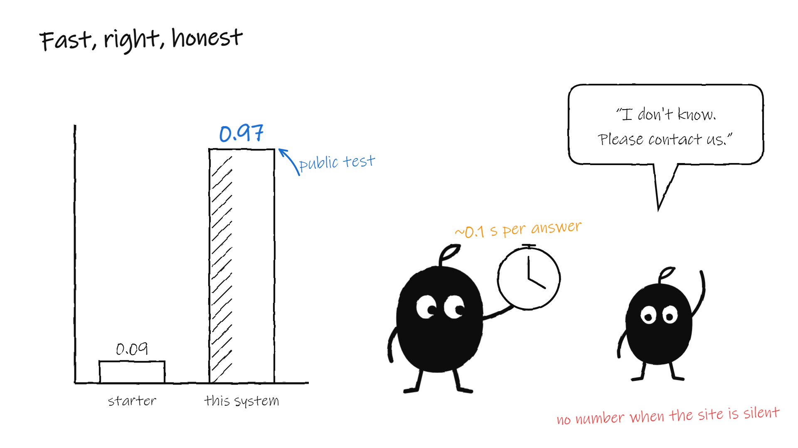
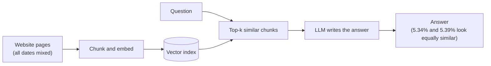
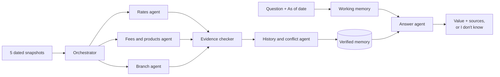
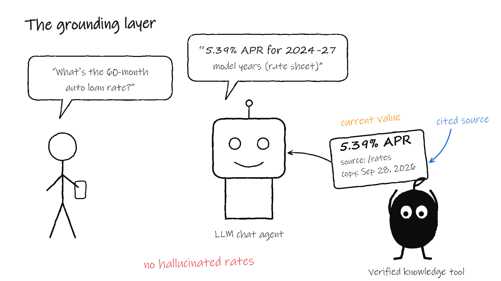

# Credit Union Assistant

**A multi-agent knowledge system that answers credit-union member questions from five dated copies of a real
credit-union website. It gives the current value, the right tier and a cited source, and it says "I don't know"
when the website is silent.**

| Public practice set | Held-out rewordings | Consistency | Answer time (p95) | API keys / paid calls |
|---|---|---|---|---|
| **0.97** (starter: 0.09) | **1.0** | **1.0** | **under 0.1 s** | **none** (Python standard library only) |


Dear evaluators, this page explains what I built, how it works, how to run it and why I designed it this way.
Each section starts with its main point.

**Contents:** [Quick start](#quick-start-for-evaluators) ·
[1. The problem](#1-the-problem) · [2. My solution: a team of agents](#2-my-solution-a-team-of-agents) ·
[3. The flows](#3-the-flows) · [4. How "current" is decided](#4-how-current-is-decided) ·
[5. Memory architecture](#5-memory-architecture) · [6. Example answers](#6-example-answers) ·
[7. Results](#7-results) · [8. Why this design](#8-why-this-design-compared-with-the-alternatives) ·
[9. Guardrails](#9-guardrails-and-security) · [10. Where it fits](#10-where-it-fits-the-grounding-layer) ·
[11. Repository map](#11-repository-map) · [12. Rules compliance](#12-rules-compliance)

---

## Quick start for evaluators

You need Python 3.9 or newer (I tested on 3.11.9). There is nothing to install: `submission/requirements.txt`
lists no packages, and the system needs no API key.

1. **Add the data.** The website snapshots are not in this repository, because they were shared for the event only.
   Copy the kit's `snapshots_zip/` folder to the repository root. The scorer unpacks it on the first run.
2. **Run the scorer** on the public practice set:

   ```
   python harness/run_eval.py --submission submission --eval eval/public_eval.jsonl
   ```

   Expected: `final_score` about 0.97, `stale_trap_hits` 0, `errors` 0. Loading all five snapshots takes 18 to
   55 seconds; it is not timed for scoring.
3. **Run the self-test and the unit tests** (they use only the small artificial data in `harness/selftest`):

   ```
   python harness/run_eval.py --submission submission --snapshots harness/selftest/snapshots --eval harness/selftest/eval.jsonl --conflicts-gold harness/selftest/conflicts_gold.json
   python -m unittest discover -s submission/tests -v
   ```

   Expected: self-test 1.0; 25 of 25 unit tests pass.
4. **Optional: try it in a browser.** `python submission/app/server.py`, then open http://localhost:8765. It is a
   chat with a sources box under each answer, an "As of" date menu, follow-up questions and a snapshot timeline.

The entry point is `submission/solution.py`. `build()` returns an object with exactly the three methods of
`harness/contract.py`: `ingest(snapshot)`, `answer(question, as_of=None)` and `conflicts()`. Nothing is renamed.

---

## 1. The problem

**A website is not a clean database.** The same fact appears with different values on different pages and
dates. The kit gives five snapshots (May 12 to September 28, 2026, 634 to 705 pages each) and expects the answer a
careful human expert would give.



These are the traps I found in the data:

| Trap in the data | Real example from the snapshots | What a naive system does |
|---|---|---|
| Old rate beside new rate | A calculator page still shows 5.34% APR; the rate page shows 5.39% | Repeats 5.34%, or lists both |
| Stale copy of a whole table | An old home-loan page shows 6.037% APR for a 30-year loan; the current rate sheet shows 7.29% | Quotes the stale table |
| Expired promotion | A promotion page keeps an offer that ended | Treats the offer as current |
| Rate vs APY vs APR | A dividend rate of 4.06% and an APY of 4.10% for the same certificate | Reports a false conflict |
| Tiers by balance, term or vehicle year | Share Savings pays 0.00% to 0.20% by balance | Gives the wrong tier |
| Old press releases | Releases say 19, 20, 22, 23 or 24 branches | Picks one at random |
| Questions about a past date | The 10-month jumbo certificate paid 3.90% in May and 4.00% in September | Answers with today's value |
| Facts the site never states | No rate is published for a 7/1 ARM | Invents a number |

The scorer punishes exactly these traps: any stale or wrong value in an answer scores zero for that question.
So the system must decide which value is true **before** it writes the answer. Listing every number does not pay.

---

## 2. My solution: a team of agents

**Six agents turn the snapshots into verified memory once, when the data is loaded. At question time, the answer
agent answers only from that memory, so it cannot invent a value.** The agents are plain, deterministic Python
components: no language model writes a fact.


| Agent | File | What it does |
|---|---|---|
| Coordinator (orchestrator) | `submission/kb/agents/coordinator.py` | Reads the snapshots oldest first. Parses only new or changed pages (content hash). Routes each block to a specialist. Rejects bad pages and out-of-order or repeated snapshots safely. |
| Rates agent | `submission/kb/agents/rates.py` | Reads rate tables and rate sentences. Keeps APR, APY, dividend rate and interest rate apart. Keeps tier, term, loan amount, vehicle year and the "effective as of" date as conditions. |
| Fees and products agent | `submission/kb/agents/fees_products.py` | Reads fees, product facts, eligibility text and organisation figures (members, branches, staff) within plausible ranges. |
| Branch agent | `submission/kb/agents/branches.py` | Reads addresses, services, hours and phone numbers from the locator and contact pages. |
| Evidence checker (verifier) | `submission/kb/agents/checker.py` | Keeps a fact only when its value, product and every condition appear in the page text. |
| History and conflict agent | `submission/kb/agents/history.py` | Finds facts that pages state with different values. Picks a winner by source authority and effective date, never by majority vote, and records the reason. Builds `conflicts()`. |
| Answer agent | `submission/kb/answer.py` | Picks the snapshot for the date, retrieves and filters evidence, checks that it supports the question, and answers with sources, or says "I don't know". |

Shared parts: the store and BM25 index (`kb/store.py`), the records (`kb/records.py`), follow-up working memory
for the chat (`kb/working_memory.py`) and the saved copy for fast UI starts (`kb/persist.py`).

---

## 3. The flows

### Ingestion: once per snapshot, oldest first



### Answering: every question, about 0.1 s



---

## 4. How "current" is decided

**The winner is chosen by rules, never by a majority vote.** My rules, in order:

1. **The date.** `as_of=None` means the newest snapshot (September 28, 2026). With a date, the system uses the newest
   snapshot on or before it, and never a later one. A month in the question ("as of May 2026") works too. A date
   before the first snapshot gives "I don't know" with the earliest date.
2. **Source authority.** Rate sheet 1.0, product and contact pages 0.9, other pages 0.7, promotions 0.5, news 0.45,
   blogs 0.35, calculators 0.3.
3. **Effective dates.** A row with a clearly newer "effective as of" date replaces an older copy of the same row.
4. **Ended offers lose.** Text such as "offer ended", or an end date before the snapshot date, removes the offer.
5. **Qualifiers are different facts, not conflicts.** Rate vs APY vs APR, 48-month vs 60-month, standard vs jumbo,
   personal vs business, and each balance or vehicle-year tier are kept apart.
6. **Honesty.** A refusal (`confident=False`) contains no numbers. It is given when the evidence does not support
   the question: words, named things, a real rate statement, a real schedule or a fee amount must be present.
7. **Removed pages** are used only when no current page answers, and the answer says that the value may be out of
   date.

The full rule list is in [`submission/NOTES.md`](submission/NOTES.md).

---

## 5. Memory architecture

**The system uses six of the seven agent memory types. It leaves out parametric memory on purpose, so no model
weight can supply a rate.**



| Memory type | What it is | Where it lives in this system |
|---|---|---|
| In-context (working) | What the agent holds during one conversation | The chat keeps the last question. "What about 72 months?" replaces the term; "What are its hours?" keeps the subject. The UI shows the joined question as "Read as". |
| Semantic | General facts | The fact store: rates, fees, terms, addresses and hours, each with product, conditions, quote and source page |
| Episodic | Events at a point in time | The timeline of five dated snapshots: "as of" answers and "did it change?" answers |
| Procedural | Rules for how to do a task | The agent rules: which page wins a conflict, how to read a rate table, when to refuse |
| External (retrieval) | Knowledge kept outside the model and looked up | The BM25 index over 129,280 passages, and a saved copy on disk that cuts the UI start from 23 s to 6 s |
| Parametric | Knowledge in model weights | Not used, on purpose: no language model writes a fact |
| Prospective | Remembering to act at a future time | Offer end dates are stored; after its end date, an offer loses to the standard rate |

---

## 6. Example answers

These are real outputs of `answer()` on the five snapshots.

**Current value, with the stale value rejected:**

> **Q:** What's the APR for a 60-month auto loan on a 2025 model-year vehicle?<br>
> **A:** Auto & Motorcycle Loans: 2024-27 Model Year (60 Months): APR **5.39%** [effective 2026-08-31]<br>
> **Sources:** dupaco.com/rates, /personal/loans/auto-loans/, /personal/loans/auto-motorcycle-loans<br>
> **Other values on the website:** 5.34% and 5.39%. **Chosen:** 5.39%. **Reason:** "Source purpose: rates page
> outranks promo page; newer effective date 2026-08-31"

**An "as of" date:**

> **Q:** What was the rate on the 10-month fixed jumbo special certificate as of May 2026?<br>
> **A:** As of 2026-05-19 (latest website copy on or before 2026-05-31): Special (10 Month Fixed Jumbo Certificate
> Special): dividend rate 3.86%; APY **3.90%**; minimum to earn $100,000 [effective 2026-03-03]

**A change across snapshots** (shortened):

> **Q:** Did the 10 month fixed jumbo special certificate rate change?<br>
> **A:** Earlier, as of 2026-05-12: ... APY **3.90%** ... [effective 2026-03-03]<br>
> Now, as of 2026-09-28: ... APY **4.00%** ... [effective 2026-09-01]

**An honest refusal:**

> **Q:** What is your rate on a 7/1 adjustable-rate mortgage?<br>
> **A:** I don't know. The website does not say this. Please contact us or visit a branch for help.<br>
> (`confident=False`, no numbers)

---

## 7. Results

**The system scores 0.97 on the public practice set, against 0.09 for the starter, and it holds up on reworded
questions it has not seen.** All figures were measured on Python 3.11.9 on October 20, 2026.



| Check | Result |
|---|---|
| Public practice set (40 questions) | 0.97 (starter: 0.09) |
| Same 40 questions, reworded by me | 0.93 |
| 20 held-out rewordings, written after the fixes | 1.0 |
| Self-test with conflict reference | 1.0 |
| Repeat and paraphrase consistency | 1.0 |
| Answer time, 95th percentile | 0.05 s (limit for full marks: 2 s) |
| Loading all five snapshots | 18 to 55 s (limit: 30 minutes) |
| Contradictions found in the real data | 37, all resolved with a reason |
| Unit tests (contract, guardrails, memory, answer rules) | 25 of 25 pass |
| Local web server security checks | 14 of 14 pass |

Public practice set by category:

| Category | Score | Category | Score |
|---|---|---|---|
| Stale traps (7) | 1.00 | Tier choice (6) | 1.00 |
| "As of" dates (4) | 1.00 | Branch information (6) | 1.00 |
| Current values (3) | 1.00 | Entity attribution (4) | 1.00 |
| Should refuse (3) | 1.00 | Conflict resolution (3) | 1.00 |
| List completeness (4) | 0.75 | | |

**Known gap:** one public item ("Get me the rate for the certificate of accounts.") lists no required values, so
the local scorer gives it 0 unless its optional language-model judge is on. My answer reads back every certificate
rate, as the reference asks. The reworded sets are test files outside the submission; no answer is stored in the
code.

---

## 8. Why this design, compared with the alternatives

**The task rewards one thing above all: the current, correctly tiered value and no stale one. So the system must
decide which evidence is true before it writes. The common alternatives decide too late or not at all.**

**Typical RAG chatbot:** similar text goes to a language model, which writes the answer.



**This system:** agents verify facts and settle conflicts at ingestion; the answer agent reads only verified,
dated memory.



Only the starter and this system were measured on the public set. The two middle columns give the expected
behaviour of each approach on this data; I did not build or measure them.

| What the task needs | Starter (keyword search) | Typical RAG + LLM writer | LLM only (parametric memory) | This system |
|---|---|---|---|---|
| Current value over a stale page | No | Partly: similarity cannot tell which page is current | No: training data is not this website | Yes: stale traps 1.00, 0 stale values |
| Right tier (balance, term, vehicle year) | Partly | Partly | No | Yes: tier questions 1.00 |
| Answer "as of" a past date | No | No, unless the index is split by date | No | Yes: as-of questions 1.00 |
| Contradiction resolved, with a reason | No | No: the model may pick one or list both | No | Yes: 37 found, each with a reason |
| Honest "I don't know" | No | Depends on the prompt | No: it can invent a rate | Yes: refusal questions 1.00, no numbers |
| Cited source and quote | Partly | Partly | No | Yes: page, snapshot and quote |
| Same answer every time | Yes | No: sampling varies | No | Yes: consistency 1.0 |
| Speed and cost per question | Fast, free | Seconds, paid per call | Seconds, paid per call | About 0.1 s, free, no API key |
| Unusual wording | Weak | Strong | Strong | Good: reworded set 0.93 |
| Measured public score | 0.09 | Not measured | Not measured | 0.97 |

Why it wins here:

1. **Truth is decided before the answer is written.** The verifier and conflict agents settle 5.34% against 5.39%
   at ingestion. A writer model never sees the stale value as an equal.
2. **Time is a first-class axis.** Episodic memory keeps each snapshot, so "as of" and "did it change?" work.
3. **No parametric memory means no invented numbers.** Weak evidence gives "I don't know", which the scorer rewards.
4. **It is auditable and repeatable.** Every answer carries its source, quote and reason; the same question gives
   the same answer.
5. **It is fast and free.** About 0.1 s per answer with no API key, far inside the 2-second full-speed mark.

Trade-offs I accept: rule-based language handling covers less wording than a language model (reworded set 0.93);
English text only; the system reads and reasons but does not act on accounts.

---

## 9. Guardrails and security

* Answers use only the supplied snapshots. No live website calls, no network access, no API keys.
* `answer()` never raises: an internal error returns an honest "I don't know". Questions are cut to 1,000
  characters, control characters are removed, and a bad `as_of` gets a clear date-format message.
* Ingestion survives damaged pages, non-http URLs, very large pages, repeated snapshots and snapshots that arrive
  out of date order.
* No `eval`, `exec`, `pickle` or `subprocess` in the submission. The UI's saved copy is gzip JSON, which cannot run
  code when loaded.
* The optional web UI binds to 127.0.0.1, serves a fixed file list, checks Host and Origin headers, limits request
  size and rate, sends strict security headers and inserts all server text with `textContent` only.

---

## 10. Where it fits: the grounding layer

**I see this system as the grounded knowledge layer of a banking assistant, not as the whole assistant.** A
conversational LLM agent owns the dialogue; this system is its verified knowledge tool for the current, cited
fact. That keeps rate answers correct as the website changes.



| What banking AI must do | How this system meets it | Gap |
|---|---|---|
| Grounded answers, no hallucination | Answers come only from verified facts; weak evidence gives "I don't know" | None |
| Show its work | Every answer cites page, snapshot and quote, and explains why one value beat another | None |
| Accuracy, transparency, auditability | Deterministic rules, logged conflicts with reasons, repeatable answers | None |
| Answer product and rate questions 24/7 | Rates, tiers, fees, branches, dates and changes in about 0.1 seconds | Rule-based wording covers less than an LLM |
| Complete tasks across core systems | Not in scope: the system reads and reasons, it does not act | Needs core integrations and transaction agents |
| Voice and many languages | Text only, English only | Needs a speech and translation layer |

---

## 11. Repository map

| Path | Content |
|---|---|
| `submission/solution.py` | `build()` and the three contract methods |
| `submission/kb/agents/` | The coordinator and the specialist, checker and history agents |
| `submission/kb/answer.py` | The answer agent |
| `submission/kb/store.py`, `records.py`, `text.py`, `pageparse.py` | Storage, BM25 index, records, text and page parsing |
| `submission/kb/working_memory.py`, `persist.py` | Chat follow-ups and the UI's saved copy (not used by the scorer) |
| `submission/app/` | The optional local web UI |
| `submission/tests/` | 25 unit tests |
| `submission/NOTES.md` | The full rule list, the memory design and the known limits |
| `harness/`, `eval/` | The hackathon scorer and the public practice set, unchanged |
| `docs/images/` | The architecture diagram and the illustrations on this page |

---

## 12. Rules compliance

| Rule from the assignment | Status |
|---|---|
| `solution.py` with `build()`, in a folder other than `starter/` | `submission/solution.py` |
| Exactly three methods, shapes from `harness/contract.py`, nothing renamed | Yes |
| `requirements.txt` and a short `NOTES.md` (how "current" is decided, which API keys) | Yes; no packages, no API keys |
| Answer only from the snapshots provided; no live website calls | Yes |
| Each `answer` call within 60 seconds; loading within 30 minutes | Slowest answer 0.07 s; loading 18 to 55 s |
| The scorer command runs cleanly from a fresh clone (with the kit's data added) | Yes: tested in a clean Python 3.11 environment |
| No hard-coded answers to the practice questions | Yes: no practice question appears in the code |
| Do not redistribute the website data | The snapshots are not in this repository |
