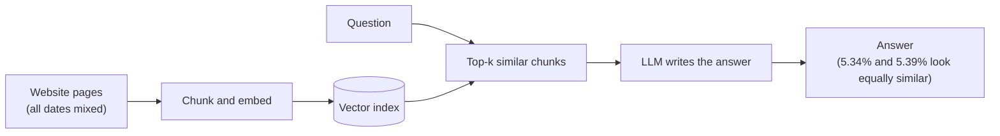
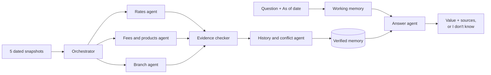

# Credit Union Assistant: Pitch and Design Brief

## Elevator pitch

I built a grounded multi-agent knowledge system for credit-union member questions. It reads five dated copies of
a real credit-union website and answers with the current value, the right tier and a cited source. When the
evidence is missing, it says "I don't know".

An orchestrator agent routes each page to specialist agents. A verifier agent writes only proven facts to
semantic memory, and a conflict agent resolves contradictions with procedural rules. At question time, the answer
agent uses working memory for follow-ups, episodic memory for "as of" dates and retrieval memory for evidence. It
has no parametric memory, so it cannot invent a rate. Answers take about 0.1 seconds, repeat exactly and cost
nothing per question. On the public test set it scores 0.97, against 0.09 for the starter solution.

## The problem

A website is not a clean database: the same fact often appears with different values on different pages and
dates. The assignment gives five snapshots (May 12 to September 28, 2026, 634 to 705 pages each) and expects the
answer a careful human expert would give.

| Trap in the data | Real example from the snapshots | What a naive system does |
|---|---|---|
| Old rate beside new rate | A calculator page still shows 5.34% APR; the rate page shows 5.39% | Repeats 5.34%, or lists both |
| Stale copy of a whole table | An old home-loan page shows 6.037% APR for a 30-year loan; the current rate sheet shows 7.29% | Quotes the stale table |
| Expired promotion | A promotion page keeps an offer that ended | Treats the offer as current |
| Rate vs APY vs APR | A dividend rate of 4.06% and an APY of 4.10% for the same certificate | Reports a false conflict |
| Tiers by balance, term or vehicle year | Share Savings pays 0.00% to 0.20% by balance | Gives the wrong tier |
| Old press releases | Releases say 19, 20, 22, 23 or 24 branches | Picks one at random |
| Questions about a past date | The 10-month jumbo certificate paid 3.90% in May and 4.00% in September | Answers with today's value |
| Facts the site never states | No rate is published for a 7/1 ARM | Invents a number |

The scoring matches these traps: any stale or wrong value in an answer scores zero for that question, so listing
every number does not pay.

## The solution: a team of agents

Six agents turn the snapshots into verified memory once, when the data is loaded. At question time, working
memory resolves a follow-up and the answer agent answers only from that memory, so it cannot invent a value.

The answer agent shows each answer with its sources, the reason for a chosen value and the other values the
website states. A question the evidence does not support gets "I don't know", with no numbers.

## Memory architecture

The system uses six of the seven agent memory types. It leaves out parametric memory on purpose, so no model
weight can supply a rate.

| Memory type | What it is | Where it lives in this system |
|---|---|---|
| In-context (working) | What the agent holds during one conversation | The chat keeps the last question. "What about 72 months?" replaces the term; "What are its hours?" keeps the subject. The UI shows the joined question as "Read as". |
| Semantic | General facts | The fact store: rates, fees, terms, addresses and hours, each with product, conditions, quote and source page |
| Episodic | Events at a point in time | The timeline of five dated snapshots: "as of" answers and "did it change?" answers |
| Procedural | Rules for how to do a task | The agent rules: which page wins a conflict, how to read a rate table, when to refuse |
| External (retrieval) | Knowledge kept outside the model and looked up | The BM25 search index over 129,280 passages, and a saved copy on disk that cuts the UI start from 23 s to 6 s |
| Parametric | Knowledge in model weights | Not used, on purpose: no language model writes a fact |
| Prospective | Remembering to act at a future time | Offer end dates are stored; after its end date, an offer loses to the standard rate |

## Why this design is the best fit for the task

The task scores one thing above all: the answer must hold the current, correctly tiered value and no stale one.
So the system must decide which evidence is true **before** it writes an answer. The common alternatives decide
too late or not at all.

### Architectures compared

**Typical RAG chatbot.** Similar text goes to a language model, which writes the answer.

**This system.** Agents verify facts and settle conflicts at ingestion. The answer agent reads only verified,
dated memory.

### Side by side

Only the starter and this system were measured on the public set. The two other columns give the expected
behaviour of the approach on this data; they were not built or measured here.

| What the task needs | Starter (keyword search) | Typical RAG + LLM writer | LLM only (parametric memory) | This system |
|---|---|---|---|---|
| Current value over a stale page | No | Partly: similarity cannot tell which page is current | No: training data is not this website | Yes: stale-trap questions 1.00, 0 stale values |
| Right tier (balance, term, vehicle year) | Partly | Partly | No | Yes: tier questions 1.00 |
| Answer "as of" a past date | No | No, unless the index is split by date | No | Yes: as-of questions 1.00 |
| Contradiction resolved, with a reason | No | No: the model may pick one or list both | No | Yes: 37 found, each with a reason |
| Honest "I don't know" | No | Depends on the prompt | No: it can invent a rate | Yes: refusal questions 1.00, no numbers |
| Cited source and quote | Partly | Partly | No | Yes: page, snapshot and quote |
| Same answer every time | Yes | No: sampling varies | No | Yes: consistency 1.0 |
| Speed and cost per question | Fast, free | Seconds, paid per call | Seconds, paid per call | About 0.1 s, free, no API key |
| Unusual wording | Weak | Strong | Strong | Good: reworded set 0.93 |
| Measured public score | 0.09 | Not measured | Not measured | 0.97 |

### Why it wins here

1. **Truth is decided before the answer is written.** The verifier and conflict agents settle 5.34% against 5.39%
   at ingestion, by source authority and effective date. A writer model never sees the stale value as an equal.
2. **Time is a first-class axis.** Episodic memory keeps each snapshot, so "as of May 2026" is answered from the
   site as it stood then, and "did it change?" compares every copy.
3. **No parametric memory means no invented numbers.** When the evidence is weak, the answer is "I don't know",
   which the scorer rewards.
4. **It is auditable.** Each answer carries its source, its quote, the reason for the chosen value and the other
   values on the site. The same question gives the same answer.
5. **It is fast and free.** Deterministic code answers in about 0.1 s with no API key, far inside the 2-second
   full-speed mark.

### Trade-offs we accept

* Rule-based language handling covers less wording than a language model (reworded set 0.93, not 1.0).
* Text and English only; no voice or translation.
* The system reads and reasons; it does not act on accounts.
* The best production design is a hybrid: a conversational LLM agent owns the dialogue and calls this system as
  its verified knowledge tool for the current, cited fact.

## Why it is different

Most retrieval chatbots find similar text and let a language model write an answer. This system decides which
evidence is true before it answers.

- **Evidence first.** An evidence-checker agent keeps a fact only when its value, product and conditions appear in
  the page text. Every answer cites the page, the snapshot and a quote.
- **Time-aware.** A question about a past date uses only the website as it stood then. A question about change
  compares every snapshot.
- **Conflicts resolved with reasons, never by majority vote.** The official rate sheet beats promotions and blogs,
  a newer effective date beats an older one, and an ended offer loses. Each choice carries its reason.
- **Honest refusals.** Guardrail checks return "I don't know" with no numbers when the evidence is weak. All
  refusal test questions pass.
- **Deterministic and cheap.** No language-model call at question time: no API key, no per-question cost, no
  hallucinated values, and the same answer every time.
- **Hardened.** Input limits, safe ingestion of damaged data, a locked-down local web server and automated
  guardrail tests.

## Results and evidence

The system scores 0.97 on the public test set, against 0.09 for the starter, and it holds up on reworded questions
it has not seen. All figures are measured on Python 3.11.9 on October 20, 2026.

| Check | Result |
|---|---|
| Public test set (40 questions) | 0.97 (starter: 0.09) |
| Same 40 questions, reworded | 0.93 |
| 20 held-out rewordings, written after the fixes | 1.0 |
| Self-test with conflict reference | 1.0 |
| Repeat and paraphrase consistency | 1.0 |
| Answer time, 95th percentile | about 0.1 s |
| Ingestion of all five snapshots | 18 to 55 s (limit: 30 minutes) |
| Web UI start: first / from the saved copy | 23 s / 6 s |
| Contradictions found in the real data | 37, all resolved with a reason |
| Unit tests (guardrails, memory, saved copy, answer rules) | 25 of 25 pass |
| Local web server security checks | 14 of 14 pass |

Known gap: one public item ("Get me the rate for the certificate of accounts.") lists no required values, so the
local scorer gives it 0 unless its optional language-model judge is on. The answer reads back every certificate
rate, as the reference asks.

## Fit with interface.ai

The system fits interface.ai as a grounded knowledge layer, not as a full banking agent.
[interface.ai](https://interface.ai/) sells agentic Voice and Chat AI to 100+ credit unions and community banks,
and its home page lists Dupaco Community Credit Union, whose website is the hackathon data, as a customer. Its
platform promise is "advanced LLMs paired with grounded, auditable knowledge", with "no room for hallucination".

| What interface.ai asks of banking AI | How this system meets it | Gap |
|---|---|---|
| Grounded answers, no hallucination | Answers come only from verified facts; weak evidence gives "I don't know" | None |
| "Can it show its work?" ([interface.ai blog](https://interface.ai/blog/agentic-ai-credit-unions-banks-questions-to-ask/)) | Every answer cites page, snapshot and quote, and explains why one value beat another | None |
| Accuracy, transparency, auditability | Deterministic rules, logged conflicts with reasons, repeatable answers | None |
| Answer product and rate questions 24/7 | Rates, tiers, fees, branches, dates and changes in about 0.1 seconds | Rule-based language handling covers less wording than an LLM |
| Complete tasks across core systems | Not in scope: the system reads and reasons, it does not act | Needs core integrations and transaction agents |
| Voice and 100+ languages | Text only, English only | Needs a speech and translation layer |

The strongest pairing: an LLM handles conversation, and this system supplies the current, verified fact with its
source. That keeps rate answers correct as the website changes.

## Two-minute pitch for managers and recruiters

Say it in five beats, in about two minutes. Use the agent and memory names from the memory architecture table.
Open the demo on the auto-loan question during beat 3.

1. **Hook (0:00 to 0:15).** "Ask a credit union's website for a car-loan rate and it can give you two answers:
   5.34% on a calculator page and 5.39% on the rate sheet. An AI agent that grounds its answer on the wrong page
   costs the member money and the credit union trust."
2. **Problem (0:15 to 0:40).** "The hackathon gave five dated copies of a real credit-union website, about 700
   pages each: stale tables, expired offers, old press releases and questions about past dates. A wrong or stale
   number scores zero. So the agent's memory must know what is true now, not only what text is similar."
3. **Architecture (0:40 to 1:15).** "I built a multi-agent system around an explicit memory architecture. An
   orchestrator agent routes each page to specialist agents for rates, fees and branches. A verifier agent writes a
   fact to semantic memory only when the page text proves it. A conflict agent applies procedural memory: source
   authority and effective date, never a majority vote. Episodic memory keeps every snapshot on a timeline, so 'as
   of May 2026' gets the site as it stood then. Prospective memory holds offer end dates, so an ended promotion
   loses. At question time, the answer agent reads retrieval memory over that verified store, and working memory
   resolves follow-ups such as 'What about 72 months?'. Every answer shows its sources, why one value won and the
   other values on the site."
4. **Proof (1:15 to 1:40).** "0.97 on the public test, against 0.09 for the starter, 1.0 on held-out rewordings,
   37 contradictions found and resolved, and about 0.1 seconds per answer. There is no parametric memory and no
   language-model call, so the cost per question is zero and no number is hallucinated."
5. **Why it matters (1:40 to 2:00).** "interface.ai promises banking agents that are grounded and auditable. This
   is that grounding layer: a conversational LLM agent can own the dialogue and call this system as its verified
   knowledge tool for the current, cited fact. I would like to build that layer with your team."
